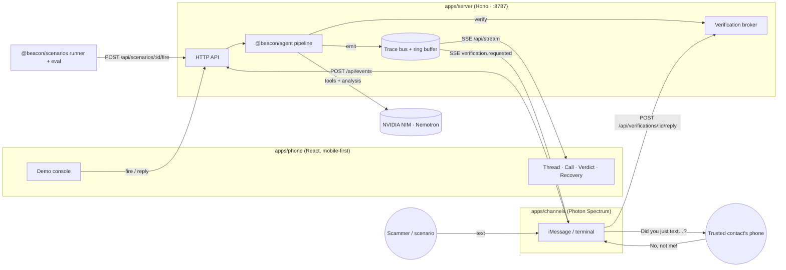

# Architecture

> **Magenta-Guard (the call screener) is described in the root `AGENTS.md` → "Architecture" and
> "API contract".** This page documents the original Beacon text pipeline, which still runs for texts.



## Packages

| Package | Runtime | Depends on |
|---|---|---|
| `@beacon/shared` | browser + node | zod |
| `@beacon/agent` | node (pure lib) | shared |
| `@beacon/scenarios` | node | shared, agent (eval) |
| `@beacon/server` | node | shared, agent, scenarios, hono |
| `@beacon/channels` | node | shared, spectrum-ts |
| `@beacon/phone` | browser | shared, react, vite, tailwind |

Internal packages are consumed as TypeScript source (`exports: ./src/index.ts`);
there's no build step except the phone bundle.

## Verification sequence

```mermaid
sequenceDiagram
  participant S as Scammer
  participant A as Agent
  participant B as Server/Broker
  participant C as Channels (Photon)
  participant M as Real Mom
  participant P as Phone UI
  S->>B: "Hi honey it's Mom, new number… gift cards"
  B->>A: run(event)
  A-->>P: trace: triage signals, score 0.71
  A->>A: claim = "sender is Mom"; sender ∉ Mom.handles
  A-->>P: verification.requested (to Mom's known handle)
  A->>B: verify(request)
  B-->>C: SSE verification.requested
  C->>M: "Did you just text asking for gift cards?"
  M->>C: "No?? That's not me!"
  C->>B: POST /verifications/:id/reply
  B->>A: { status: replied, reply }
  A->>A: interpretReply → denied (+4.0 log-odds)
  A-->>P: verification.resolved, verdict: SCAM 98%
```

In mock/simulator mode, the broker auto-replies with the scenario's
`trustedContactReply`, or the demo console replies by hand.

## Confidence math

`pScam = logistic(prior + Σ signal.weight)`, with `prior = -1.5` (most messages are
benign). Each signal is a log-odds contribution with a source (`heuristic`,
`classifier`, `llm`, `tool`, `verification`). LLM contributions are capped at ±2.5
so no single model opinion dominates. Labels come from shared thresholds:
`scam ≥ 0.80 > suspicious ≥ 0.40 > safe`. The `band` widens when sources disagree or
verification is missing. The eval harness measures calibration (ECE) so the band is
based on measurement.

## Trace events (SSE `event: trace`)

`event.received` · `stage` (started/completed/skipped) · `thought` · `signal` · `tool` ·
`privacy` · `verification.requested` · `verification.resolved` · `score` · `verdict` · `error`.
Envelope: `{ seq, eventId, at }`. Replay with `?since=<seq>`.

## Privacy boundaries

| Data | Leaves the device? |
|---|---|
| Messages triage marks clearly safe | Never |
| Suspicious message text | Yes, **after redaction** (phones, emails, card numbers, SSNs, codes → placeholders) |
| Contact names | No: replaced with relationships ("the user's mother") |
| Safe words | Never: compared locally only, and never logged or traced |
| Verification question | Sent only to the trusted contact's known-good handle |
